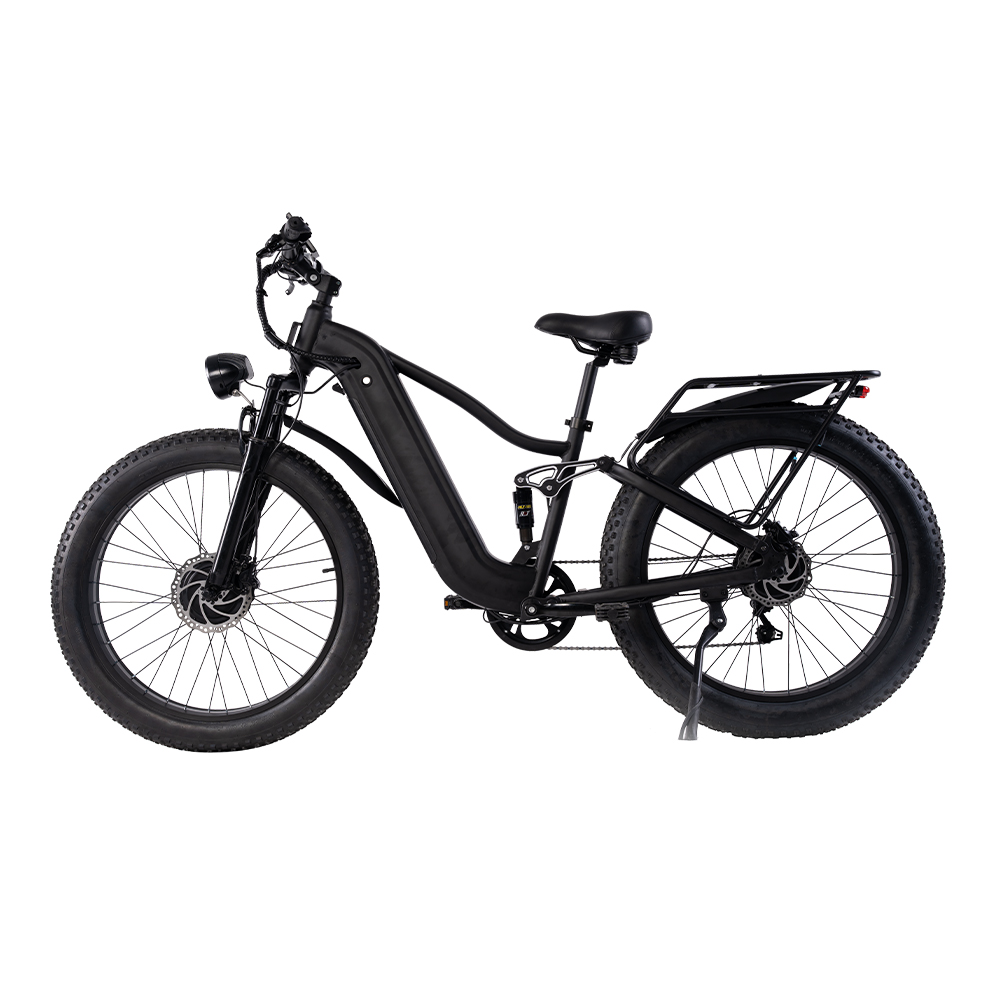

# S26-PRO-D — 26" Premium Snow Fat-Tire Electric Bike, 1000W Dual-Drive AWD

**Premium Snow Dual-Drive** — 26" × 4.0 · 52 V · 1000 W AWD

---

## Why this one

It is the bike we build when "electric" isn't enough. Two 500 W hub motors — one
front, one rear — both driven at once, with the cockpit showing you what each motor
is actually doing. Twenty-six inch tyres at 4.0 wide for snow that would stop a
narrower bike dead. A 4-link frame with a rear shock, because a bike that asks you
to ride snow at 15 km/h still needs to handle itself when you get off the throttle.

The vertical colour display is the detail riders notice first: front/rear power
split, five assist levels, and a status readout that tells you what's wrong instead
of just going quiet.

**45 km/h (28 mph)** for U.S. builds, **25 km/h** for EU/UK — set at the factory,
locked before shipping.

---

## Highlights

- **1000 W AWD** — 500 W front + 500 W rear hub motors, independent power readout
- **~936 Wh battery** — 52 V 18 Ah, 14S4P, 21700 cells, UL 2271 certified
- **Vertical colour display** — front/rear motor power, 5 assist levels, decimal status codes
- **4-link frame + rear shock** — 26" × 4.0 snow tyres, 150 mm rear travel
- **80 mm front fork** with mechanical lockout, unlocks for loose ground
- **Hydraulic disc brakes** — 2-piston, 180 mm rotors
- **Shimano 7-speed** drivetrain

---

## Specifications

| Item | Specification |
|------|---------------|
| Category | Premium Snow Dual-Drive |
| Motor | Front 500 W + rear 500 W hub — 1000 W AWD |
| Controller | 58.8 V, 9-tube dual-drive, 2 × 20 A limit, ISO 13849 |
| Battery | 52 V 18 Ah (14S4P, 21700) · ~936 Wh · UL 2271 |
| Voltage | 52 V nominal / 58.8 V full charge |
| Charger | 58.8 V / 3.0 A, DC5521, CE + UL |
| **Top speed** | **45 km/h (28 mph) US · 25 km/h EU/UK — factory-set** |
| Assist levels | 5 assist levels + 0 (off) |
| Frame | 26" Sea Lion 4-link, RC 530 mm |
| Front fork | 290S, 80 mm travel, mechanical lockout |
| Rear shock | 150 mm coil, 450 lb, preload adjustable |
| Wheels | 26 × 4.0 snow tyres, 15–20 PSI |
| Transmission | Shimano 7-speed — TZ500 14–28T freewheel, TY21 derailleur, TX30 shifter, 48T chainring |
| Brakes | Hydraulic disc, 2-piston, 180 mm rotors |
| Display | Vertical colour display, 102.7 × 62.8 mm |
| Lighting | 48 V LED headlight + rear light with brake and turn |
| Approx. weight | 55.5 kg incl. battery |
| Certifications | UL 2271 · UL 1004 · ISO 13849 · CE · RoHS |

> Figures not listed here — range, charge time, packaging dimensions — vary with
> battery state, terrain, rider weight and assist level. Ask us for a configuration
> sheet for your market.

---

## Photos

17 white-background angles in [`Photos/`](Photos/), following the repo-wide angle
convention.

---

[← Back to lineup](../../README.md) · [Full comparison matrix →](../../02_Specs/)