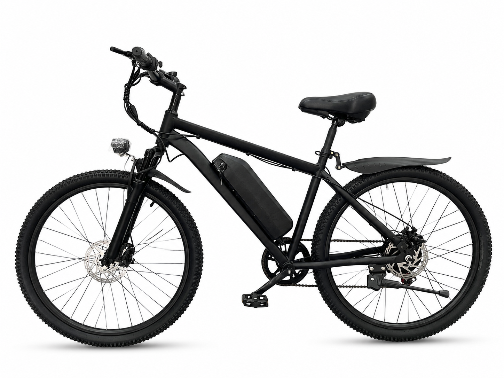

# S5

**Mountain E-Bike** — 26 inch x 2.125 · 48 V · 350 W

---

## Why this one

The straightforward one. A steel frame, a rear hub motor that does its job quietly,
and mechanical disc brakes that will stop you before the battery does. Air-sprung
front fork with a mechanical lockout so you can firm it up for the tarmac.

It is the bike you get when you want assistance on the climb and nothing else
happening on the descent.

**25 km/h** — the standard EU/UK e-bike limit, set at the factory.

---

## Highlights

- **350 W rear hub motor** — single drive, front wheel free
- **48 V 9 Ah** — 21700 cells, 13S2P
- **188S spring suspension fork** with mechanical lockout
- **Mechanical disc brakes** — 160 mm front and rear
- **Colour display** with status readout
- **Shimano 7-speed** drivetrain, 14-28T

---

## Specifications

| Item | Specification |
|------|---------------|
| Category | Mountain E-Bike |
| Motor | 350 W rear hub |
| Battery | 48 V 9 Ah (21700, 13S2P) |
| Voltage | 48 V nominal / 54.6 V full charge |
| Charger | 54.6 V / 2 A |
| **Top speed** | **25 km/h — factory-set** |
| Frame | Steel, 26 inch |
| Front fork | 188S spring suspension, mechanical lockout, 100 mm axle-to-crown |
| Wheels | 26 x 2.125 |
| Rims | 26 inch x 13G x 36H alloy, double-wall |
| Transmission | Shimano 7-speed, TY21B derailleur, TX50 shifter, 14-28T |
| Brakes | Mechanical disc, 160 mm front and rear |
| Display | Colour display |
| Lighting | Front + rear light with turn signals |
| Certifications | UL / CE targeted for battery, controller, charger |

> Range, charge time, weight and packaging vary with configuration and battery
> state. Ask us for a configuration sheet for your market.

---

## Photos

5 white-background angles in [`Photos/`](Photos/).

---

[Back to lineup](../../README.md) · [Full comparison matrix](../../02_Specs/)