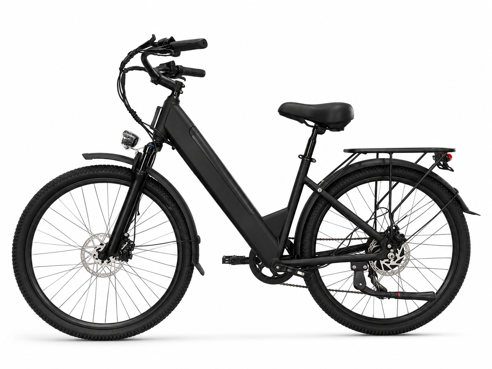

# S6 — 26" City Step-Through Electric Bike, 350W Rear Hub, 48V

**City Step-Through E-Bike** — 26 inch x 2.125 · 48 V · 350 W

---

## Why this one

The S5 drivetrain in a frame you can actually get on. Low step-through, upright
riding position, and the battery tucked into an alloy box on the down tube — so
stepping over the frame doesn't mean swinging a leg over a lump of dead weight.

A commuter that behaves like one: lights with turn signals, mechanical discs that
work in the wet, and a 25 km/h limit that keeps you out of trouble on shared paths.

**25 km/h** — the standard EU/UK e-bike limit, set at the factory.

---

## Highlights

- **350 W rear hub motor**
- **48 V 9 Ah** — 21700 cells, 13S2P
- **Step-through frame** with an integrated alloy battery box
- **Spring suspension fork** with adjustable mechanical lockout
- **Mechanical disc brakes** — 160 mm front, 180 mm rear
- **Colour display** with status readout
- **Shimano 7-speed** drivetrain, 14-28T

---

## Specifications

| Item | Specification |
|------|---------------|
| Category | City Step-Through E-Bike |
| Motor | 350 W rear hub |
| Battery | 48 V 9 Ah (21700, 13S2P) |
| Voltage | 48 V nominal / 54.6 V full charge |
| Charger | 54.6 V / 2 A |
| **Top speed** | **25 km/h — factory-set** |
| Frame | Steel step-through with alloy battery box |
| Front fork | Spring suspension, adjustable mechanical lockout |
| Wheels | 26 x 2.125 |
| Transmission | Shimano 7-speed, TX30 shifter, 14-28T |
| Brakes | Mechanical disc, 160 mm front / 180 mm rear |
| Display | Colour display |
| Lighting | Front + rear light with turn signals |
| Certifications | UL / CE targeted for battery, controller, charger |

> Range, charge time, weight and packaging vary with configuration and battery
> state. Ask us for a configuration sheet for your market.

---

## Photos

6 white-background angles in [`Photos/`](Photos/).

---

[Back to lineup](../../README.md) · [Full comparison matrix](../../02_Specs/)