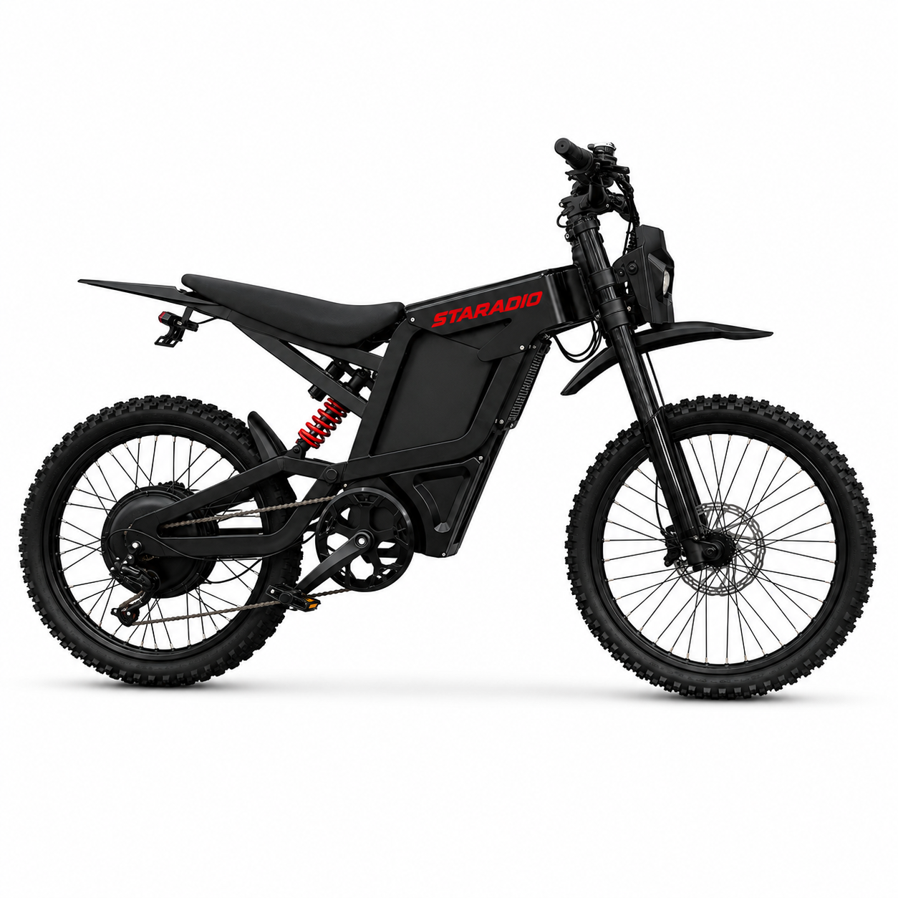

# S700PRO — 19" Performance Electric Moped, 3000W Peak, 60V 35Ah

**Moped Flagship** — 19 inch · 60 V · 3000 W peak rear hub

---

## Why this one

The flagship. A 60 V 35 Ah pack — the largest battery we ship — feeding a 3000 W
peak rear hub, and the braking to match it: 203 mm discs with a 4-piston caliper
where the rest of the range uses two.

If you are going to build a moped around one component, build it around this.

---

## On top speed

We do not publish a speed figure for this model yet.

Its hardware is capable of well above the legal limit in every market we sell into,
and the factory limit for each destination is still being confirmed. Rather than
print a number that would be wrong everywhere, **ask us for the configured limit
for your market, or book a test ride.**

---

## Highlights

- **3000 W peak** rear hub motor on a 60 V platform
- **60 V 35 Ah** — the largest pack in the range
- **4-piston hydraulic calipers**, 203 mm rotors — the only 4-piston bike we build
- **Dual hydraulic rear shocks** — 220 mm, 1200 lb
- **Aluminium hydraulic fork** with thru-axle
- **Colour LCD display** with status readout

---

## Specifications

| Item | Specification |
|------|---------------|
| Category | Moped Flagship |
| Motor | 3000 W peak rear hub |
| Battery | 60 V 35 Ah (16S, 21700) |
| Voltage | 60 V nominal / 67.2 V full charge |
| Charger | 60 V / 5 A |
| **Top speed** | **Not published — limit set per market, confirm with us** |
| Frame | 19 inch moped platform |
| Front fork | Aluminium hydraulic, thru-axle |
| Rear shocks | Dual hydraulic, 220 mm, 1200 lb |
| Wheels | 70/100-19 |
| Transmission | Shimano 7-speed, TX50 shifter |
| Brakes | Dual hydraulic disc, 203 mm, 4-piston |
| Display | Colour LCD display |
| Lighting | Front + rear light |
| Certifications | UL charger; UL materials for battery and motor |

> Range, charge time, weight and packaging vary with configuration and battery
> state. Ask us for a configuration sheet for your market.

---

## Photos

5 renders in [`Photos/`](Photos/).

> ⚠️ These are **product renders**, not photography. Colours and finish may differ
> slightly from the delivered bike — photography is in production.

---

[Back to lineup](../../README.md) · [Full comparison matrix](../../02_Specs/)