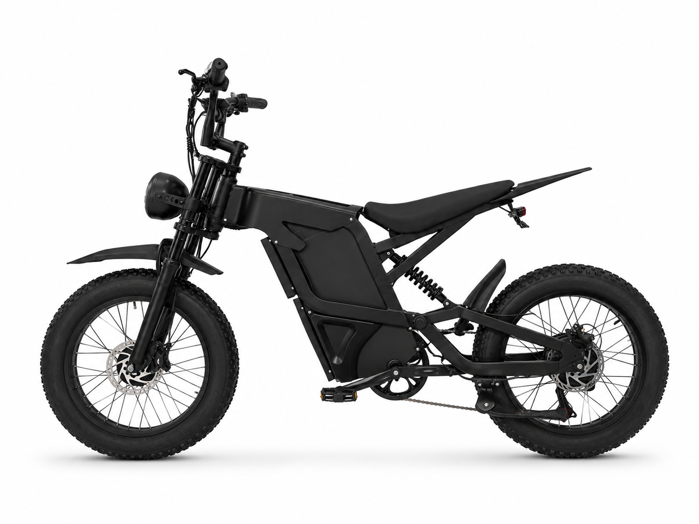

# S700SE-D

**Snow Moped Dual-Drive** — 20 inch x 4.0 · 52 V · 1000 W AWD

---

## Why this one

A moped-class machine with a moped's licence-free practicality and a snow bike's
grip: 19 inch chassis, 20 x 4.0 tyres, and both axles driven. Dual hydraulic disc
brakes front and rear, because 1000 W plus a full battery plus a rider is a serious
amount of momentum to stop.

**35 km/h** — a road-legal figure in most markets, set at the factory.

---

## Highlights

- **1000 W AWD** — independently driven front and rear hub motors
- **52 V 25 Ah** battery
- **20 x 4.0 snow tyres** on a 19 inch moped chassis
- **Dual hydraulic disc brakes** — 160 mm rotors
- **Dual rear shocks** — 1500 lb air shocks
- **Colour LCD display** with status readout

---

## Specifications

| Item | Specification |
|------|---------------|
| Category | Snow Moped Dual-Drive |
| Motor | Front 500 W + rear 500 W — 1000 W AWD |
| Battery | 52 V 25 Ah |
| Voltage | 52 V nominal / 58.8 V full charge |
| Charger | 52 V / 3 A |
| **Top speed** | **35 km/h — factory-set** |
| Frame | 19 inch moped platform, steel |
| Front fork | Spring suspension, steel |
| Rear shocks | Dual air shocks, 1500 lb |
| Wheels | 20 x 4.0 |
| Transmission | Shimano 7-speed |
| Brakes | Dual hydraulic disc, 160 mm rotors |
| Display | Colour LCD display |
| Lighting | Front + rear light with turn signals |
| Certifications | UL materials for battery and motor |

> Range, charge time, weight and packaging vary with configuration and battery
> state. Ask us for a configuration sheet for your market.

---

## Photos

8 white-background angles in [`Photos/`](Photos/).

---

[Back to lineup](../../README.md) · [Full comparison matrix](../../02_Specs/)