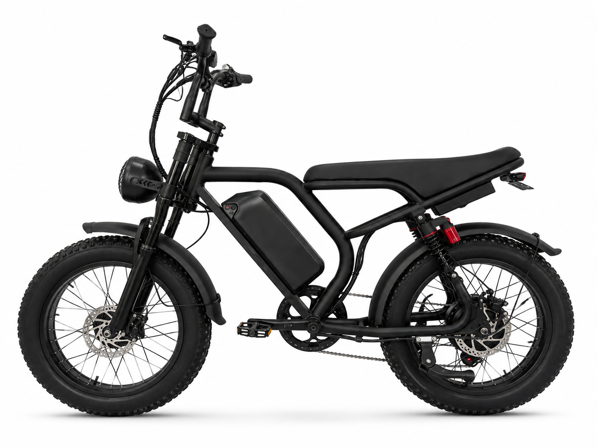

# S8-D — 20" Fat-Tire Snow Electric Bike, 1000W Dual-Drive AWD

**Snow Fat-Tire Dual-Drive** — 20 inch x 4.0 · 48 V · 1000 W AWD

---

## Why this one

The snow bike that started the range. 1000 W of all-wheel drive on 20-inch fat
tyres, in a package that is easier to handle than the 26 inch flagship — narrower,
and 20 inch wheels roll through soft snow with less rotational inertia.

It's the bike you buy once if you want AWD traction and a full day of riding without
watching the battery gauge.

**45 km/h (28 mph)** for U.S. builds, **25 km/h** for EU/UK — factory-set and
locked before shipping.

---

## Highlights

- **1000 W AWD** — 500 W front + 500 W rear hub motors
- **48 V 25 Ah** — 21700 cells, UL 2271 certified
- **20 x 4.0 fat tyres** — 20 PSI, built for packed snow
- **Dual hydraulic disc brakes** — 180 mm rotors front and rear
- **10 W headlight** with a rear light that carries brake and turn signals
- **Shimano 7-speed** drivetrain, 14-28T

---

## Specifications

| Item | Specification |
|------|---------------|
| Category | Snow Fat-Tire Dual-Drive |
| Motor | Front 500 W + rear 500 W hub — 1000 W AWD |
| Battery | 48 V 25 Ah (21700, 13S5P) · UL 2271 |
| Voltage | 48 V nominal / 54.6 V full charge |
| Charger | 54.6 V / 2 A |
| **Top speed** | **45 km/h (28 mph) US · 25 km/h EU/UK — factory-set** |
| Frame | Steel, matte black, integrated controller box |
| Front fork | Spring suspension, 50 mm travel |
| Wheels | 20 x 4.0 fat tyres, 20 PSI |
| Transmission | Shimano 7-speed, 14-28T freewheel |
| Brakes | Dual hydraulic disc, 180 mm rotors |
| Display | LCD digital display with status readout |
| Lighting | 10 W headlight + rear light with brake and turn |
| Certifications | UL 2271 · UL 1004 · ISO 13849 · CE · RoHS |

> Range, charge time, weight and packaging vary with configuration and battery
> state. Ask us for a configuration sheet for your market.

---

## Photos

6 white-background angles in [`Photos/`](Photos/).

---

[Back to lineup](../../README.md) · [Full comparison matrix](../../02_Specs/)