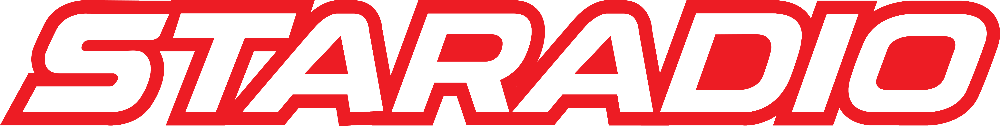

<div align="center">

</div>

# STARADIO Electric Bikes — Fat-Tire Snow & Dual-Drive AWD

**Fat-Tire Snow · Dual-Drive AWD · Commuter · Mountain · Moped**

Seven models. One obsession — nothing that doesn't hold up.

[Website](https://staradiobikes.com) · [Contact](https://staradiobikes.com)

---

## The Lineup

| Model | Category | Drive | Battery | Wheels | Top Speed |
|-------|----------|-------|---------|--------|-----------|
| **[S26-PRO-D](01_Models/S26-PRO-D/)** | Premium Snow Dual-Drive | 1000 W AWD (500 F + 500 R) | 52 V 18 Ah · ~936 Wh | 26 × 4.0 | 45 km/h US · 25 km/h EU |
| **[S8-D](01_Models/S8-D/)** | Snow Fat-Tire Dual-Drive | 1000 W AWD (500 F + 500 R) | 48 V 25 Ah | 20 × 4.0 | 45 km/h US · 25 km/h EU |
| **[S700SE-D](01_Models/S700SE-D/)** | Snow Moped Dual-Drive | 1000 W AWD (500 F + 500 R) | 52 V 25 Ah | 20 × 4.0 | 35 km/h |
| **[S5](01_Models/S5/)** | Mountain | 350 W rear hub | 48 V 9 Ah | 26 × 2.125 | 25 km/h |
| **[S6](01_Models/S6/)** | City Step-Through | 350 W rear hub | 48 V 9 Ah | 26 × 2.125 | 25 km/h |
| **[S700SE](01_Models/S700SE/)** | Moped Economy | 1500 W rear hub | 52 V 25 Ah | 19" | Set per market — test ride |
| **[S700PRO](01_Models/S700PRO/)** | Moped Flagship | 3000 W peak rear hub | 60 V 35 Ah | 19" | Set per market — test ride |

Full comparison matrix → [`02_Specs/`](02_Specs/)

---

## What we build on

**Dual motors, actually wired.**
Four of the seven models run front + rear hub motors with independent power
readout. On snow, sand and wet clay, two driven wheels are the difference between
traction and a dig.

**Batteries we can actually ship.**
UL 2271 certified packs, 21700 cells, real watt-hour figures.

**Brakes, not decoration.**
Hydraulic disc brakes across the dual-drive and moped lines, sized for the weight
and speed they have to stop.

**Speed limits set honestly.**
Every bike ships limited to the legal ceiling for its destination market. We publish
the number we can stand behind, and where a model's verified limit isn't confirmed
we publish no number at all rather than quoting a datasheet.

---

## Certifications

| Scope | Held |
|-------|------|
| Battery | **UL 2271** |
| Motors | **UL 1004** materials |
| Controller | **ISO 13849** functional safety |
| Charger | **CE + UL** |
| Display | **CE + RoHS** |

Whole-vehicle certification for the U.S. market is in progress. We do not describe
a bike as "certified" on the strength of its components alone.

---

## Technical Documentation

We publish our interface protocols — the same documents our own assembly and
service teams work from.

- [`Lithium Battery Protocol No.2`](04_Technical/Motor_Controller/Lithium-Battery-Protocol-No2.md) — BMS ↔ controller status bits, fault codes, field definitions
- [`KM5S Protocol V1.0`](04_Technical/Motor_Controller/KM5S-Protocol-V1.0.md) — controller ↔ instrument signalling

---

## Repository Layout

```
01_Models/<MODEL>/     Marketing page, full spec sheet, white-background photos
02_Specs/              Cross-model comparison matrix, how we publish specs
03_Brand/              Brand story and positioning
04_Technical/          Interface protocol documents
05_Assets/             Brand assets (logos, templates)
06_Accessories/        Accessories catalogue
PUBLISHING_RULES.md     What may and may not be published here
```

Photo naming follows a fixed angle convention — `LeftFront`, `RightFront`,
`LeftFrontSide`, `RightFrontSide`, `LeftRearSide`, `RightRearSide` — so the same
asset works across storefronts and marketplaces without re-shooting.

---

## About This Repo

This is a **public marketing repository**. It contains product information, imagery
and interface documentation only.

Supplier quotations, bills of materials, supplier contact details and internal cost
data are **not** published here and never will be. The rules that govern this repo
are written down in [`PUBLISHING_RULES.md`](PUBLISHING_RULES.md) — including which
performance figures we are and are not allowed to publish, and why.

If you are a prospective distributor or reseller, the
[website](https://staradiobikes.com) is the right place to start.

---

<div align="center">
<strong>STARADIO</strong> — <a href="https://staradiobikes.com">staradiobikes.com</a>
</div>